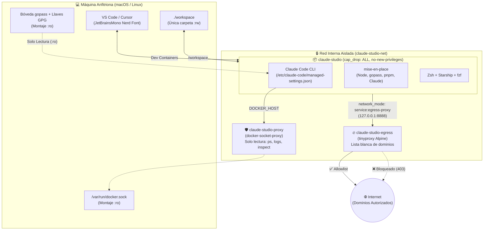
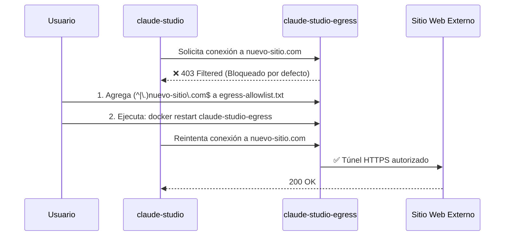

# Claude Studio

Entorno de trabajo aislado y endurecido para ejecutar **Claude Code** en tareas de propósito general (investigación, manejo de documentos, automatización y desarrollo) con mínimo privilegio en macOS y Linux.

---

## 🏗️ Arquitectura del Entorno

`claude-studio` separa la ejecución del agente de IA mediante **tres contenedores aislados** dentro de una red interna, evitando el acceso directo al sistema anfitrión, la escalada de privilegios o la exfiltración de datos hacia servidores desconocidos.



---

## 🛡️ Medidas de Seguridad Incluidas

- **Aislamiento de red (*Egress Filtering*):** `claude-studio` no tiene salida directa a internet; enruta todo su tráfico a través de `claude-studio-egress` (`tinyproxy` sobre Alpine), que bloquea por defecto cualquier conexión fuera de `.devcontainer/settings-files/egress-allowlist.txt`.
- **Cero capacidades de kernel (`cap_drop: ALL`)** y bloqueo de escalada de privilegios (`no-new-privileges:true`), con `tmpfs` en memoria volátil para procesos temporales y sockets de `gpg-agent`.
- **Aislamiento del socket de Docker** mediante `docker-socket-proxy` (bloqueo total de `POST`, `EXEC`, `VOLUMES` y `SECRETS`; solo permite `ps`, `logs` e `inspect`).
- **Políticas inmutables** en `/etc/claude-code/managed-settings.json` (`root:root`, `644`) con aislamiento de lectura/escritura fuera de `/workspace`, limpieza de variables de entorno en subprocesos (`CLAUDE_CODE_SUBPROCESS_ENV_SCRUB=1`) y bloqueo de `--dangerously-skip-permissions`.
- **Integración segura con `gopass`** montado en estricto solo lectura (`:ro`).

---

## 📁 Estructura del Repositorio

```text
claude-studio/
├── .devcontainer/
│   ├── containers/
│   │   ├── compose.yaml            # Orquestación de servicios y redes aisladas
│   │   ├── Dockerfile              # Imagen base Ubuntu + Zsh + Starship + políticas
│   │   └── Dockerfile.egress       # Imagen Alpine mínima para el proxy de salida
│   ├── scripts/
│   │   ├── bootstrap.sh            # Instalación declarativa de herramientas con mise
│   │   └── install-nerd-font.sh    # Instalador automático de JetBrainsMono Nerd Font en el host
│   ├── settings-files/
│   │   ├── .zshrc                  # Configuración de Zsh, fzf, plugins y alias (cc, ccr)
│   │   ├── egress-allowlist.txt    # Lista blanca de dominios oficiales permitidos
│   │   ├── managed-settings.json   # Políticas de seguridad y rendimiento de Claude Code
│   │   ├── starship.toml           # Prompt visual segmentado
│   │   └── tinyproxy.conf          # Configuración del cortafuegos proxy
│   └── devcontainer.json           # Definición del Dev Container para VS Code / Cursor
├── workspace/
│   ├── CLAUDE.md                   # Directivas de comportamiento y alcance para Claude
│   └── mise.toml                   # Versiones declarativas (Node, gopass, pnpm, Claude Code)
├── .gitignore
└── README.md
```

---

## 📋 Requisitos Previos en el Host

1. Tener instalado **Docker** (con Docker Compose v2).
2. Tener instalado **VS Code** o **Cursor** con la extensión **Dev Containers** (opcional si se usa desde terminal).
3. Guardar tu API Key de Anthropic en `gopass`:
   ```bash
   gopass insert claude/anthropic_api_key
   ```
   *(Si usas suscripción Claude Pro/Max con OAuth, elimina la línea `"apiKeyHelper"` en `.devcontainer/settings-files/managed-settings.json` y ejecuta `claude auth login` dentro del contenedor).*
   *(Nota de plataforma: En macOS, `compose.yaml` monta `\${HOME}/Library/Application Support/gopass`. En Linux, ajusta esa línea a `\${HOME}/.local/share/gopass`).*

---

## 🚀 Uso

### Opción 1: Desde VS Code / Cursor
1. Abre la carpeta `claude-studio`.
2. Ejecuta en la paleta de comandos (`Cmd + Shift + P` / `Ctrl + Shift + P`): **`Dev Containers: Reopen in Container`**.
3. Abre la terminal integrada (`Ctrl + \``) y ejecuta `claude` (o el alias `cc` / `ccr` para retomar sesión).

### Opción 2: Desde la terminal
```bash
cd .devcontainer/containers && docker compose up -d --build
docker exec -it claude-studio /usr/local/bin/bootstrap.sh
docker exec -it claude-studio claude
```
*(Consejo: Si tu llave GPG en el host tiene contraseña, ejecuta `gopass show -o claude/anthropic_api_key` una vez dentro del contenedor para desbloquear `gpg-agent` en memoria antes de iniciar `claude`).*

---

## 🔥 Cómo Agregar Nuevos Dominios a la Lista Blanca

Si al pedirle a Claude que consulte una URL nueva (`WebFetch`) o al instalar un paquete aparece un error de red (`403 Filtered` o `tunnel error: unsuccessful`), significa que el dominio no está en la lista blanca del proxy.



1. Abre **`.devcontainer/settings-files/egress-allowlist.txt`** en tu máquina anfitriona.
2. Añade el dominio al final (el prefijo `(^|\.)` autoriza tanto el dominio principal como todos sus subdominios):
   ```text
   (^|\.)nuevo-dominio\.com\$
   ```
3. Reinicia únicamente el proxy desde tu terminal anfitriona (no cierra tu sesión ni reconstruye el contenedor):
   ```bash
   docker restart claude-studio-egress
   ```

---

## 🛠️ Agregar Nuevas Herramientas con `mise`

Para añadir herramientas adicionales (como `python`, `uv`, `ripgrep`, `jq`, `go`, etc.) sin tocar el `Dockerfile`:
1. Añade la herramienta en **`workspace/mise.toml`**.
2. Ejecuta `mise install` dentro de la terminal del contenedor.
